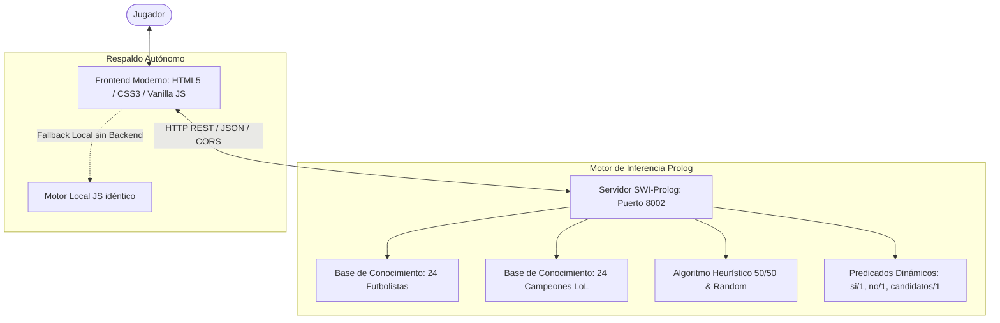

# 🎮 ¿Quién es Quién? — Duelo 1v1 vs IA (Fútbol & League of Legends)

<p align="center">
  
</p>

<p align="center">
  
  
  
  
  
</p>

---

## 📖 Descripción General

**¿Quién es Quién?** es una reimplementación moderna del clásico juego de mesa adaptado como un **duelo 1v1 por turnos contra una Inteligencia Artificial** construida en **SWI-Prolog**.

Tanto tú como la IA eligen un personaje en secreto de un tablero dinámico de 20 cartas. En cada turno, deberás formular preguntas estratégicas sobre los atributos del personaje rival o arriesgarte a adivinar su identidad. ¡El primero en descubrir el personaje del rival gana el duelo!

El juego incluye dos grandes mundos temáticos: **Estrellas del Fútbol Mundial** y **Campeones de League of Legends**, así como un **Modo Mixto** que fusiona ambos universos.

---

## ✨ Características Destacadas

* 🧠 **Motor de Inferencia y Heurística en Prolog**:
  * **Modo Difícil**: La IA calcula matemáticamente qué rasgo divide el conjunto de candidatos restantes lo más cerca posible al **50% (entropía óptima)**, maximizando el descarte por turno.
  * **Modo Fácil**: La IA selecciona preguntas casuales de forma aleatoria.
  * **Adivinanza Inteligente**: Cuando la IA deduce que solo queda 1 sospechoso válido, lanza la adivinanza para la victoria.
* ⚽⚔️ **48 Personajes Detallados**:
  * **24 Futbolistas**: Messi, Cristiano Ronaldo, Mbappé, Haaland, Vinicius, Modrić, Bellingham, De Bruyne, Salah, etc. (posiciones, ligas, pie hábil, Balones de Oro, Champions, físicos).
  * **24 Campeones de LoL**: Yasuo, Ahri, Jinx, Garen, Lee Sin, Zed, Lux, Thresh, Teemo, Viego, etc. (roles, carriles, regiones de Runaterra, recursos, tipos de daño).
* 🪙 **Sorteo de Primer Turno**: Lanzamiento de moneda en 3D para decidir aleatoriamente quién empieza la partida.
* 🃏 **Tablero Interactivo con Cartas 3D (*Flip Cards*)**:
  * **Descarte Asistido**: Al responderse una pregunta, las cartas de personajes descartados se voltean automáticamente en 3D con efectos sonoros.
  * **Volteo Manual**: Puedes hacer clic sobre cualquier carta para voltearla o desvoltearla cuando desees.
* 🔊 **Audio Sintetizado en Tiempo Real (Web Audio API)**:
  * Efectos procedimentales nativos (moneda al aire, volteo de cartas, aciertos, fallos y fanfarria de victoria) sin necesidad de cargar archivos externos `.mp3`, con botón de silenciar.
* ⚡ **Arquitectura Híbrida Inteligente**:
  * Se conecta de forma automática a la **API REST de SWI-Prolog** en `http://localhost:8002`.
  * Si el servidor Prolog no está corriendo, activa de forma transparente un **motor local autónomo en JavaScript** con exactamente la misma base de conocimiento y algoritmo 50/50, asegurando que el juego siempre funcione de inmediato.

---

## 🎯 Reglas del Juego

1. **Selección Secreta**: Al iniciar la partida, se presenta el tablero y eliges qué personaje serás tú. La IA elige el suyo en secreto del mismo tablero.
2. **Moneda al Aire**: Un sorteo aleatorio define quién tiene el primer turno.
3. **Tu Turno**: Puedes elegir una de dos acciones (ambas consumen el turno):
   * **Hacer Pregunta**: Selecciona un rasgo mediante el selector organizado por categorías (Posición, Región, Armas, Apariencia, etc.).
   * **¡Adivinar Personaje!**: Arriésgate a decir quién es el personaje secreto de la IA. Si aciertas, ¡ganas inmediatamente! Si fallas, pierdes el turno.
4. **Turno de la IA**: La IA formula una pregunta sobre tu personaje (o intenta adivinar si ya te descubrió). El sistema responde automáticamente *"SÍ"* o *"NO"* basado en tu personaje secreto.
5. **Victoria**: Gana el jugador que adivine primero el personaje secreto del rival.

---

## 🏗️ Arquitectura del Sistema



---

## 🚀 Instalación y Puesta en Marcha

### Método 1: Lanzador en 1 Clic (Recomendado para Windows)
Simplemente haz doble clic sobre el archivo:
```text
iniciar_servidor.bat
```
Este script:
1. Añade temporalmente SWI-Prolog al `PATH` si es necesario.
2. Abre la interfaz en tu navegador predeterminado.
3. Inicia el servidor SWI-Prolog en `http://localhost:8002`.

---

### Método 2: Manual desde Terminal

1. **Iniciar el servidor Prolog**:
   ```bash
   cd akinator_prolog
   swipl -s main.pl
   ```
   *(El servidor HTTP iniciará en el puerto 8002 con el mensaje del sistema)*.

2. **Abrir el juego**:
   Abre el archivo `index.html` en tu navegador web favorito (Chrome, Edge, Firefox, Brave).

---

### Método 3: Modo Directo (Sin servidor Prolog)
Si no tienes SWI-Prolog instalado o quieres jugar rápidamente en cualquier dispositivo:
* Haz doble clic directo en **`index.html`**.
* El juego detectará que el servidor no está corriendo y activará automáticamente el **Motor Local Autónomo** con todas las reglas y personajes intactos.

---

## 📡 Referencia de la API REST de SWI-Prolog

El backend en Prolog expone los siguientes endpoints sobre `http://localhost:8002`:

| Método | Endpoint | Descripción | Parámetros (JSON) |
| :--- | :--- | :--- | :--- |
| `GET` | `/` | Health check del servidor | Ninguno |
| `POST` | `/api/iniciar` | Inicia una nueva partida, genera el tablero y el secreto de la IA | `{ "modo": "futbol"\|"lol"\|"mixto", "dificultad": "facil"\|"dificil", "num_cartas": 20 }` |
| `POST` | `/api/fijar_personaje_usuario` | Registra el personaje secreto elegido por el usuario | `{ "personaje_id": "lionel_messi" }` |
| `POST` | `/api/usuario_preguntar` | Evalúa la pregunta del usuario contra el secreto de la IA | `{ "rasgo": "delantero" }` |
| `POST` | `/api/usuario_adivinar` | Valida el intento de adivinanza del usuario | `{ "personaje_id": "yasuo" }` |
| `POST` | `/api/turno_ia` | Ejecuta la mejor jugada de la IA (pregunta heurística o adivinanza) | Ninguno |
| `POST` | `/api/resetear` | Limpia los predicados dinámicos de la partida | Ninguno |

---

## 📁 Estructura del Proyecto

```text
akinator_prolog/
├── css/
│   ├── game.css             # Estilos modernos, animaciones 3D y glassmorphism
│   ├── bootstrap.min.css    # Soporte auxiliar
│   └── defecto.css          # Estilos heredados
├── js/
│   ├── app.js               # Controlador de interfaz, eventos y flujo del duelo
│   ├── game_engine.js       # Conector API REST + Motor local autónomo de respaldo
│   ├── audio.js             # Sintetizador procedural con Web Audio API
│   └── dictionary.js        # Diccionario de términos
├── images/
│   └── banner.png           # Banner del juego
├── main.pl                  # Base de conocimiento, lógica de inferencia y servidor Prolog
├── index.html               # Aplicación web moderna en HTML5
├── iniciar_servidor.bat     # Lanzador automático de 1 clic para Windows
└── README.md                # Documentación del proyecto
```

---

## 🛠️ Tecnologías Utilizadas

* **Lógica Simbólica & Backend**: [SWI-Prolog](https://www.swi-prolog.org/) (módulos HTTP, JSON y CORS).
* **Frontend**: HTML5 Semántico, CSS3 moderno (Variables CSS, Flexbox, Grid, 3D Transforms) y JavaScript ES6+.
* **Audio**: Web Audio API (Síntesis de osciladores en tiempo real).
* **Fuentes**: [Outfit](https://fonts.google.com/specimen/Outfit) & [Inter](https://fonts.google.com/specimen/Inter) vía Google Fonts.
* **Imágenes**: CDN oficial de Riot Games (Data Dragon) e imágenes de alta definición.

---

## 👥 Créditos y Autoría

* **Desarrollo Base Original**: Carlos Batista & César Méndez.
* **Reingeniería, Modo 1v1, Motor Heurístico 50/50 y Diseño Moderno**: Proyecto "¿Quién es Quién? (Fútbol & League of Legends)".
